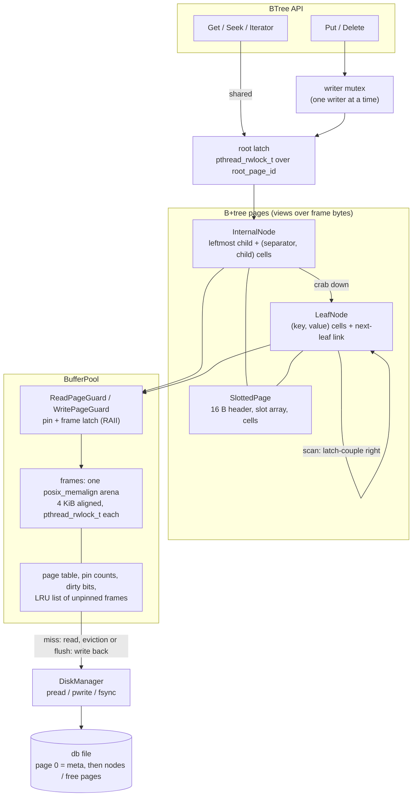

# BTreeKV

A disk-backed B+tree key/value storage engine in C++17.

The whole database lives in one file of 4 KiB pages. Pages are cached in a buffer pool
whose frames are allocated page-aligned (`posix_memalign`) and replaced in LRU order.
Every frame has its own `pthread_rwlock_t` latch. Readers run concurrently, using
read-latch crabbing on the way down the tree. Writers are serialized by a tree-level
mutex and take write latches only on the pages they might modify.

The project is about the index structure and its latching protocol. The buffer pool is
only as complex as the tree needs.

## Features

- Keys and values are arbitrary byte strings (keys up to 256 B, values up to 1024 B,
  embedded NULs allowed). Keys are ordered as unsigned bytes, the same as `std::string`.
- `Get`, `Put` (insert or overwrite), `Delete`, and ordered scans (`Begin`, `Seek`, `Next`).
- Slotted 4 KiB pages with variable-length cells, fragmentation tracking and compaction.
- Leaf and internal splits balanced by bytes rather than by entry count, so mixes of
  small and large entries always split into two halves that fit. The root grows when it
  splits.
- On delete, an underfull leaf absorbs its right sibling when they share a parent, and a
  root left with one child collapses. Freed pages go on a persistent free list and are
  reused before the file grows.
- Data survives close and reopen: page 0 holds the root, free-list head, page count,
  height and entry count.
- `CheckInvariants()` walks the whole tree and checks key order, separator bounds, node
  levels, the leaf chain and the entry count. The tests call it constantly.

## Architecture



### On-disk layout

| Page | Contents |
| --- | --- |
| 0 | Meta: magic `BTREEKV1`, version, page size, root id, free-list head, page count, height, entry count |
| leaf | type, level 0, slot count, cell start, fragmented bytes, own id, **next leaf**; slots; cells `u16 klen, u16 vlen, key, value` |
| internal | same header with level ≥ 1 and **leftmost child** in the link field; cells hold `(separator, child id)` |
| free | type `kFree`, link = next free page |

An internal node with separators `K0..Kn-1` sends a key `k` to child `UpperBound(k)`.
Child `i+1` holds keys `>= Ki`. Leaf splits copy the right half's first key up into the
parent. Internal splits push the middle key up.

### Concurrency protocol

- **Readers** take the root latch in shared mode, latch the root page, release the root
  latch, then crab: latch the child, then release the parent. A reader holds at most two
  page latches at a time.
- **Writers** take the writer mutex, then the root latch and pages exclusively on the way
  down. When a child is *safe*, every latch above it is released: for an insert, safe
  means the child has room for the new entry or separator; for a delete, it means the
  child cannot trigger a merge or a root collapse. Readers are blocked only on the part
  of the path that can still change.
- **Scans** hold a read latch on the current leaf and latch-couple to the next leaf
  (left to right). Leaf merges also go strictly left to right, absorbing the right
  sibling. With every latch acquired top-down and left-to-right, the latch graph has no
  cycles.
- Latches are only taken on pinned frames, so an evicted frame is never latched. On
  glibc the rwlocks are created writer-preferring, so readers crabbing through the root
  cannot starve the writer.

### Limitations

- No write-ahead log. A crash between flushes can leave the file inconsistent. `Flush()`
  and closing the tree persist everything.
- Internal nodes are never merged or redistributed. A leaf that is the rightmost child of
  its parent can stay underfull. After heavy deletion the tree wastes space, but lookups
  stay correct.
- The buffer pool does disk I/O while holding its mutex, so misses are serialized.
- The pool must have enough frames for every pinned page at once: about two per
  concurrent reader or iterator, plus the writer's root-to-leaf path and two more.
  Running out raises `BufferPoolExhausted`.
- A live iterator holds a read latch. Don't write from the thread that owns one.
- Values are stored in host byte order, so files can't be moved between machines with
  different endianness.

## Layout

```
include/btreekv/   public headers (config, disk_manager, buffer_pool, page_guard,
                   rwlatch, slotted_page, leaf_node, internal_node, meta_page, btree)
src/               implementations
tools/             btreekv_cli (put/get/del/scan) and btreekv_bench
tests/             GoogleTest suite
```

## Build

Requires CMake ≥ 3.16, a C++17 compiler and a POSIX system (Linux or macOS).

```sh
cmake -S . -B build -DCMAKE_BUILD_TYPE=Release
cmake --build build -j
```

By default CMake downloads GoogleTest v1.14.0 with `FetchContent`. To use an installed
copy, pass `-DBTREEKV_USE_SYSTEM_GTEST=ON`. To skip the tests or the tools, pass
`-DBTREEKV_BUILD_TESTS=OFF` or `-DBTREEKV_BUILD_TOOLS=OFF`.

## Run

```sh
# one-shot commands
./build/btreekv_cli demo.db put user:1 alice
./build/btreekv_cli demo.db get user:1
./build/btreekv_cli demo.db scan user: 10
./build/btreekv_cli demo.db del user:1
./build/btreekv_cli demo.db stats

# interactive (values may contain spaces in this mode)
./build/btreekv_cli demo.db
btreekv> put greeting hello world
btreekv> scan
btreekv> check
btreekv> quit
```

The CLI exits with 0 on success, 1 if the key was not found and 2 on a usage error.

### Benchmark

```sh
./build/btreekv_bench --keys 200000 --value-bytes 100 --pool-frames 1024 --readers 4 --seconds 3
```

The benchmark creates a fresh database file and measures:

- sequential puts
- random gets
- a full scan
- random overwrites
- point readers running for a fixed time alongside one writer
- deleting half the keys
- a final flush

It prints ops/s for each phase and buffer pool hit, miss and eviction counts. Results
depend on the machine and the OS page cache, so no numbers are quoted here. Add `--keep`
to keep the database file afterwards.

## Test

```sh
ctest --test-dir build --output-on-failure
# or run the binary directly, e.g. a single suite:
./build/btreekv_tests --gtest_filter='ConcurrencyTest.*'
```

| Suite | Covers |
| --- | --- |
| `DiskManagerTest` | page round trips, zero-fill of allocated-but-unwritten pages, reopen, malformed files |
| `BufferPoolTest` | frame alignment, hits/misses, pin counts, pinned pages never evicted, LRU victim order, dirty write-back on eviction and flush, guard latching |
| `PageLayoutTest` | header offsets, cell format, ordering, bounds, compaction, non-destructive leaf upsert, internal routing |
| `BTreeTest` | basic ops, size limits, multi-level growth, max-size entries, scans and seeks, merges and root collapse |
| `BTreeRandomTest` | tens of thousands of random put/delete/get ops checked against `std::map`, with pools small enough to force constant eviction; free page reuse |
| `PersistenceTest` | contents, deletes, overwrites and the free list survive reopen; header contents; foreign files rejected |
| `ConcurrencyTest` | point readers and range scanners checking a stable key set while a writer splits and merges the same leaves; eviction pressure; several writer threads |
